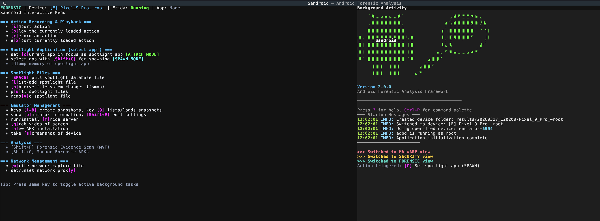
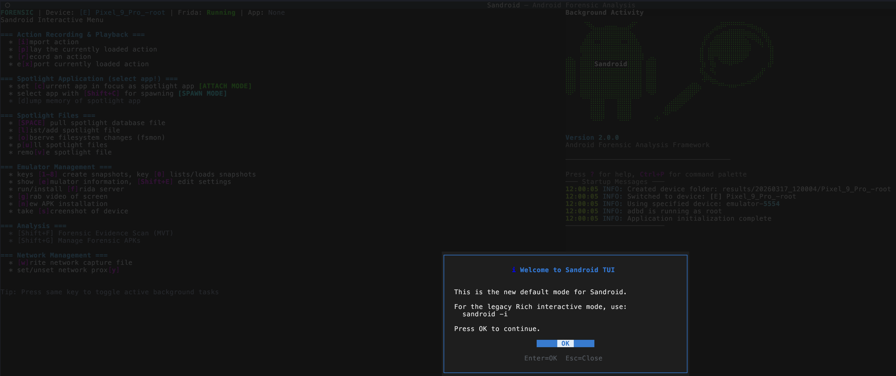
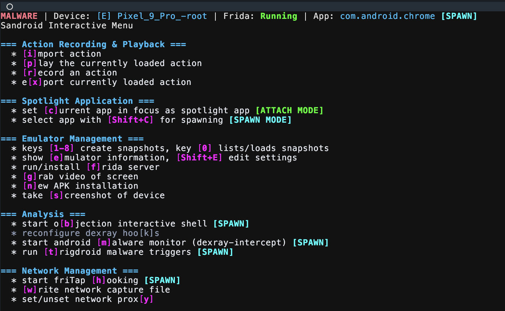
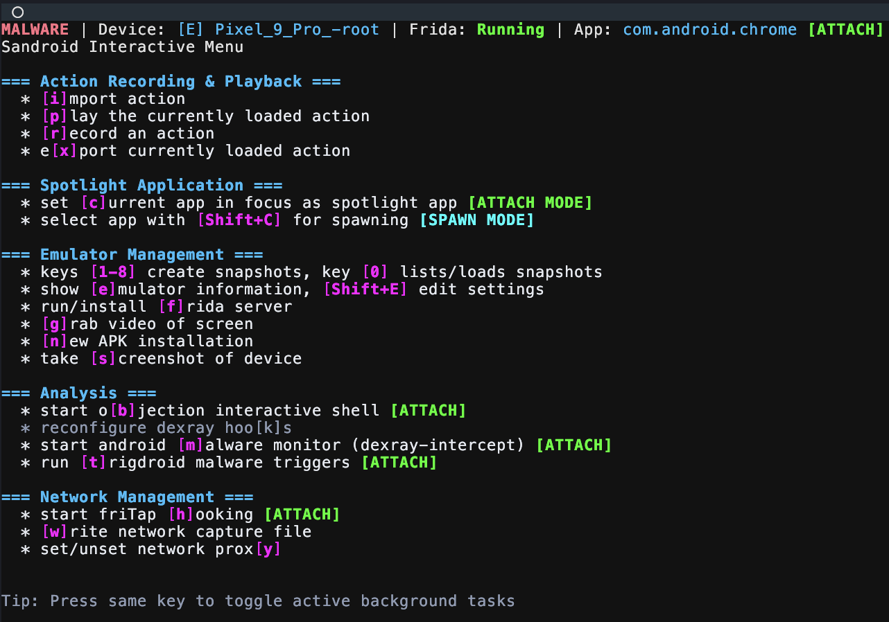

<div align="center">
    
    <p></p><strong>Android Sandbox for Automated Forensic, Malware, and Security Analysis</strong></div></p>
</div>

# Sandroid Framework
 [](https://badge.fury.io/py/Sandroid)

[](https://github.com/fkie-cad/Sandroid_core/actions/workflows/tests.yml)
[](https://github.com/fkie-cad/Sandroid_core/actions/workflows/lint.yml)
[](https://github.com/fkie-cad/Sandroid_core/actions/workflows/publish.yml)


Sandroid provides a powerful **Android sandbox framework** that enables automated analysis of Android applications.
It combines both **static** and **dynamic** techniques to help security researchers, forensic analysts, and malware analysts better understand how apps behave in a controlled environment.

By using this framework, you can:

- **Extract forensic artifacts** generated by Android apps and identify which app created them.
- **Analyze malware behavior** through automated static and dynamic analysis.
- **Uncover security vulnerabilities** and misconfigurations in Android applications.
- Gain deeper insights into app behavior without manual reverse engineering.

The framework is designed to simplify the process of **forensic investigations**, **mobile threat detection**, and **security testing** by providing a streamlined, automated environment for analysis.
Whether you're investigating malicious apps, assessing security flaws, or collecting digital evidence, this solution helps you quickly identify and understand what happens inside Android applications.

## Requirements

- **Python 3.12 or 3.13** (Python 3.10/3.11 are no longer supported as of 2.1).
- **Android SDK** platform-tools (`adb`) and the Android Emulator (e.g. via Android Studio). `sandroid-config init` auto-detects both.
- **A rooted Android emulator (AVD).** Sandroid needs root on the device (it runs `adb root`, pushes and starts `frida-server`, and sets SELinux to *permissive* with `setenforce 0` itself). Two setups are known to work:
  - a **Google APIs** system image (`google_apis`, *not* `google_apis_playstore`) — `adb root` works out of the box; or
  - a **Google Play** system image rooted with [rootAVD](https://gitlab.com/newbit/rootAVD) (Magisk) **plus the Magisk `adb_root` module**, so that `adbd` itself runs as root. This is how the Sandroid team's own AVDs are set up.
- **AVD snapshots** must be enabled — the record/play workflow and the snapshot picker (`S`) rely on them. Do **not** start the emulator with `-no-snapshot`; if you do not want the emulator to overwrite its quick-boot snapshot on exit use `-no-snapshot-save` (or simply start it via `sandroid-config avd start`).
- **Physical devices** are only partially supported: they must be rooted, and everything that relies on the emulator (snapshots, emulator-console network capture/degradation, `-no-snapshot-*` boot modes) is unavailable.
- Linux and macOS are the primary platforms; Windows works best via WSL2.

## Quick Start

```bash
# Install from PyPI
pip install sandroid

# Initialize configuration (detects the Android SDK and lets you pick/create an AVD)
sandroid-config init

# Start your AVD (keeps snapshots enabled)
sandroid-config avd start

# Launch the interactive TUI
sandroid
```

See [SETUP.md](SETUP.md) for all installation possibilities.

## Interactive TUI

Sandroid's default interface is an interactive terminal UI (Textual) built around **lenses**: one full-width analysis view at a time, details only on demand. Top to bottom: a one-row **header** (device ▸ app breadcrumb, the `● LIVE` / `◆ REVIEW` scope pill, clock), a 1–2 row **status strip** (app state, frida-server, hooks/bypass, proxy), the **lens bar**, the active lens, a one-row **log ticker** (newest log line) and the footer.

| Key | Lens | What it shows |
|---|---|---|
| `1` | **App** | The app under investigation: start / resume (`Enter`), attach (`A`), start paused (`P`), restart (`R`), kill (`K`), clear (`X`); `b` then `1`–`5` toggles the Frida bypass categories (SSL, Root, Frida, Debug, Integrity), `b` `o` opens Objection. |
| `2` | **Network** | Who the app talks to and what it sent: one flow table (time · recipient · request · status · size) from the embedded `mitmweb`, `Enter` for Summary / Request / Response in the Inspector; TLS failures show as ✗ rows. `/` filters (host, path, app or status; `Esc` clears it), `T` shows the spotlight (target) app only, `N` shows OS noise (hidden by default; the caption says how many flows it hides). `Home`/`End` jump to the first/last flow. Proxy state sits in the frame caption; `I` opens the Capture status page (mitmproxy + friTap). See below. |
| `3` | **Files** | One table of live file activity per file; watched files (★, `w`) are pinned on top and pulled/diffed with `u`/`U`. `N` shows the hidden noise (caches, temp files, OS paths), as in the Network lens. |
| `4` | **Runs** | Record → Play run history with the changed / new / deleted diffs (see below). |

`Shift+←/→` also cycles the lenses. `Enter` on a row opens the **Inspector** on the right where a lens supports it; `Esc` closes it. `Ctrl+Y` opens the **AI Chat** in the same right-hand slot. `` ` `` (backtick) opens the **log drawer** with the full activity log.

**Snapshots** are a picker, not a tab: `S` (or `0`) lists the AVD's snapshots — create (`c`), load (`Enter`/`l`, confirmed), delete (`d`), assign to a slot (`a`), load slot `1`–`8` (confirmed), and `s` then a digit saves the current state into a slot (8 slots per AVD). `Ctrl+1`–`Ctrl+8` save into a slot directly, but `Ctrl`+digit only reaches Sandroid in terminals with the kitty keyboard protocol (kitty, WezTerm, foot, Ghostty, recent iTerm2).

`?` opens the **help & keybinding editor** (every action grouped by category; rebind any key with live conflict detection, persisted to `tui.keybindings`), `Ctrl+Shift+P` opens the **command palette**, `D` switches devices and `q` (or `Ctrl+C` / `Ctrl+Q`) quits after a confirmation; quitting stops mitmweb and friTap and clears the device proxy Sandroid set, and never hangs on a tool that does not stop. Common operations are a single keypress (e.g. `y` proxy settings, `w` network capture, `o` file monitor, `f` frida-server, `s` screenshot, `n` install APK, `Ctrl+P` toggle SSL unpinning).

> The 2.0 "views" (Forensic / Malware / Security, switched with `TAB`) are gone — all actions live in one flat catalog. Fully non-interactive runs are available via `--headless`.

<p align="center">
  
</p>

### Record → Play and run history

From any panel, `r` records your interactions with the device (Esc/Enter in the recording window stops and saves) and `p` plays them back, landing on the **Runs** lens (`4`): Sandroid reverts the emulator to the snapshot taken before recording, replays the recording, measures background noise with a dry run of the same duration (unless `--avoid-strong-noise-filter`) and diffs the filesystem, so only artifacts caused by your action remain (changed / new / deleted files with inline diffs, processes, sockets, network). Every Play is stored as a self-contained **run bundle** under `<results_path>/runs/<run_id>/` (`run.json` manifest, `recording.txt`, the raw pull tree) and listed in the Runs lens, scoped to the active device. Runs are never deleted automatically. `Enter` on a run opens its summary, changes and report in the Inspector; `v` **reviews** it — the header shows `◆ REVIEW #<n> <run>` and the Files and Network lenses show that run instead of the live session until `L` (or `v` again) returns to LIVE. `p` asks before it reverts the device (with the recording's name and an estimated duration); while it runs the header shows the phase (`● REPLAY · replay 1/2`, `dry run`, `analysing`). A run's mitmproxy flows are stored in its bundle (`network/flows.jsonl`, covered by `SHA256SUMS`) tagged by phase, so REVIEW shows the replays' traffic — also in a later session — with the dry-run noise hidden (`A` shows it). Runs of the same recording that disagree strongly are flagged `≠` in the Runs table, the Inspector and `=` compare.

### File monitor (kprobe)

The file monitor (`o`) streams filesystem events from the device into the **Files** lens. The default backend (`tui.monitor_backend = "kprobe"`) uses kernel tracefs kprobes: kernel-verified per-PID attribution, following the whole child-process tree, path-scoped capture, and no binary pushed to the device. On kernels without the required support it falls back to the `fsmon` binary automatically (or set `monitor_backend = "fsmon"`).

An app's data directory is watched under all its names (`/data/data/<pkg>`, `/data/user/0/<pkg>`, `/data/user_de/0/<pkg>`) and shown as one row per file. Each write is named by the kernel at write time (the write probe reads the file's directory chain), so writes through files the app opened before the monitor started -- its databases, when you attach to a running app -- appear live like any other. Watched files and every pulled version with its diff (newest `tui.watchlist_max_versions`, default 10) are kept per device under `~/.config/sandroid/watchlists/` and survive a restart.

## Usage

```
Usage: sandroid [OPTIONS]

  Sandroid: Extract forensic and malware artifacts from Android Virtual Devices.

Core Options:
  -c, --config PATH               Configuration file path
  -e, --environment TEXT          Environment name (development, testing, production)
  -f, --file PATH                 Save output to the specified file
  -ll, --loglevel [DEBUG|INFO|WARNING|ERROR|CRITICAL]
                                  Set the log level
  --fresh                         Start as if running for the first time
  --version                       Show the version and exit

Analysis Options:
  -n, --number INTEGER            Run action n times (minimum 2)
  --avoid-strong-noise-filter     Disable dry run and intra-file noise detection
  --network                       Capture traffic and show connections
  -d, --show-deleted              Reveal deleted files via full filesystem checks
  --no-processes                  Do not monitor active processes
  --sockets                       Monitor listening sockets
  --screenshot INTERVAL           Take a screenshot each INTERVAL seconds
  --trigdroid PACKAGE_NAME        Execute malware triggers for PACKAGE_NAME
  --hash                          Create MD5 hashes of changed and new files
  --apk                           List all APKs and their hashes
  --degrade-network               Simulate UMTS/3G network conditions
  --whitelist FILE                Exclude paths from outputs

Headless Mode:
  --headless                      Run without interactive UI
  --batch CONFIG_FILE             Batch processing config (JSON)
  --mode [forensic|malware|security|network]
                                  Analysis mode for headless operation (default: malware)

Dexray & Advanced Tools:
  --dexray PACKAGE                Start Dexray-Intercept monitoring for PACKAGE
  --dexray-hooks HOOKS            Comma-separated hook groups (aes,web,socket,filesystem,database,dex,java_dex)
  --dexray-fritap                 Enable FriTap during dexray monitoring
  --fritap PACKAGE                Start FriTap SSL/TLS key extraction for PACKAGE
  --fridump PACKAGE               Dump memory of PACKAGE using Fridump
  --duration SECONDS              Network capture duration (headless, default: 60)
  --with-fritap PACKAGE           Combine network capture with FriTap keylog

Device Management:
  --proxy IP:PORT                 Set HTTP proxy on device
  --proxy-clear                   Clear HTTP proxy settings
  --install-apk PATH              Install APK on device
  --import-action PATH            Replay a run bundle's recording.txt headless
  --device-settings FILE          Apply device settings from JSON file
  --preset CODE                   Apply country preset (e.g., de, us, ru, cn)

Output & Debugging:
  --report                        Generate PDF report
  --debug                         Enable debug/verbose mode
  --log                           Show log messages in terminal
```

> **Note:** `--mode` only affects headless runs. Removed since 2.0: `-i`/`--interactive` (legacy Rich menu), `--ai` (Gemini video summary) and the TUI view switch (`--view`). Results of a session are written to `./results/<timestamp>/` (`sandroid.json`, `sandroid.log`, per-device raw data and screenshots).


## Network Interception & Bypass

Sandroid can route a target app's traffic through an embedded **mitmproxy** instance and defeat the common defences that get in the way of inspection. Everything lives in the **Network** lens (`2`); each step is its own keystroke, so none has a surprising side effect on the others:

| Key | Action |
|---|---|
| `Enter` (while nothing is captured) / `M` | start / stop `mitmweb` (proxy on `mitmproxy.proxy_port`, web UI on `mitmproxy.web_port`; defaults `127.0.0.1:8080` and `http://127.0.0.1:8081/`); start does **not** touch the device unless `mitmproxy.auto_device_proxy = true` |
| `Ctrl+D` | toggle the **Device Proxy** (global `http_proxy` setting → our mitmproxy) |
| `Ctrl+N` | install the mitmproxy CA into the device's **system** trust store |
| `y` | **Proxy Settings** modal: Device Proxy, **App Proxies** and CA in one place |
| `Ctrl+R` | restart `mitmweb` and re-apply device + app proxies |
| `Ctrl+O` / `Ctrl+A` | open the web UI (already logged in with its access token) / manage addons |
| `I` | Capture status page (mitmproxy and friTap state, keys, recent messages); mitmproxy's messages also go to the log drawer (`` ` ``) |

Requires `mitmweb` on `PATH` (`pip install mitmproxy`).

Ports come from `[mitmproxy]` in the config (`proxy_port`, `web_port`). mitmproxy listens on `127.0.0.1` only (`mitmproxy.listen_host`), so intercepted traffic is not exposed to the LAN. That is enough for emulators (the device reaches the host loopback as `10.0.2.2`) and for USB devices routed via `adb reverse` (Proxy Settings, `y`). Only a physical device on Wi-Fi needs `listen_host = "0.0.0.0"`. Starting mitmproxy leaves the device alone by default; set `mitmproxy.auto_device_proxy = true` to also point the Device Proxy at it on `Enter`. The Device Proxy Sandroid set is cleared when mitmproxy stops and when Sandroid exits.

**App Proxies.** Besides the global device proxy, individual apps can be routed through a proxy *per UID*: Sandroid pushes a small [gost](https://github.com/go-gost/gost) redirector to the device and adds iptables `REDIRECT` rules for that app only — either to Sandroid's mitmproxy or to an external proxy such as Burp or ZAP. QUIC (UDP/443) is blocked for proxied apps by default (`focus.block_quic`) so they fall back to interceptable TCP/TLS. On emulators the host IP is detected automatically; an `adb reverse` fallback is offered when the device cannot reach the host.

**CA certificate injection.** Sandroid auto-detects the host CA certificate from mitmproxy (`~/.mitmproxy/mitmproxy-ca-cert.pem`), HTTP Toolkit, or Burp Suite (a custom path is also accepted) and injects it into the device's system trust store. On Android 14+ (API ≥ 34) it bind-mounts the certificate into the Conscrypt APEX trust store; on Android 10–13 it injects into the Zygote mount namespace (after confirmation, since this restarts Zygote). It also writes the Chrome command-line flags needed to bypass Certificate Transparency enforcement.

**Certificate-pinning & detection bypass — EXPERIMENTAL.** Sandroid ships a Frida-based bypass suite with five categories — **SSL** unpinning, **Root**, **Frida**, **Debug** and **Integrity** (PairIP / licensing / attestation gates) detection — toggled with `1`–`5` in the **Spotlight** tab (`Ctrl+P` is a global shortcut for SSL unpinning). SSL unpinning is tiered: Java (`SSLContext`, OkHttp `CertificatePinner`, Conscrypt, WebView, TrustKit, Certificate Transparency), native BoringSSL, Chromium/cronet BoringSSL (including stripped, symbol-less builds), and mbedTLS / Meta Network Stack, with early-init hooks and a spawn-reliability ladder for hardened apps. All categories live in a single resident, flag-gated Frida script, so toggling one is instant and never leaves the app momentarily un-hooked. These bypasses are under active development: expect individual apps to defeat them, and verify results independently.

> These bypasses require a rooted AVD with `frida-server` running and a target app attached or spawned first.

**Custom mitmproxy addons.** You can load your own [mitmproxy addons](https://docs.mitmproxy.org/stable/addons-overview/) alongside Sandroid's built-in traffic logger. An addon is a standard mitmproxy script — a Python file that defines event hooks like `def response(flow): ...`, optionally a class exposing `addons = [...]`. Sandroid scans two drop-in folders for top-level `*.py` files (an `examples/` subdirectory is ignored):

- `~/.config/sandroid/mitm_addons/` — per-user; created on first run with a `README.md` and an `examples/example_logger.py` template.
- `./mitm_addons/` in the current working directory — handy for shipping addons together with a project.

To enable addons, press `Ctrl+A` in the Network lens for the addon manager — a checklist of every discovered addon. Tick the ones to load (or type a custom path directly); the selection is saved to your config under `mitmproxy.enabled_addons` and restored on the next run. A minimal addon looks like this:

```python
# ~/.config/sandroid/mitm_addons/log_urls.py
def response(flow):
    print(f"[my-addon] {flow.request.pretty_url} -> {flow.response.status_code}")
```

Editing an already-loaded addon file **hot-reloads** it live — no restart, no dropped traffic. Changing *which* addons are enabled restarts `mitmweb` (which briefly resets the live flow counters).

> Addons run as arbitrary, unsandboxed Python with the proxy process's privileges. Only enable scripts you trust.

With its modular architecture, Sandroid integrates multiple companion tools to cover a wide range of analysis capabilities — from cryptographic key extraction to TLS interception and network traffic decryption.

### Related Projects within the Sandroid Sandbox

Sandroid integrates and builds upon several companion projects that extend its capabilities.
These tools are developed under the same sandbox ecosystem and are designed to work together for comprehensive Android analysis:

| Project | Description | Status |
|--------|------------|--------|
| [**TrigDroid**](https://github.com/fkie-cad/Sandroid_TrigDroid) | Dynamic tracing and Frida-based interception for Android apps, enabling enhanced runtime analysis. | ✅ Integrated |
| [**Dexray Insight**](https://github.com/fkie-cad/Sandroid_Dexray-Insight) | A static analysis tool focused on DEX files, helping to uncover cryptographic usage, API patterns, and potential vulnerabilities. | ✅ Integrated |
| [**Dexray Intercept**](https://github.com/fkie-cad/Sandroid_Dexray-Intercept) | Dynamic hooking framework for intercepting sensitive data flows, network traffic, and runtime behaviors in Android apps. | ✅ Integrated |
| [**friTap**](https://github.com/fkie-cad/friTap) | TLS key extraction and decrypted traffic interception for Android, enabling advanced network analysis in sandboxed environments. | ✅ Integrated |


## AI Chat (EXPERIMENTAL)

Sandroid includes an LLM-backed chat assistant that can drive the same device and analysis actions as the TUI, talking to any **OpenAI-compatible** chat-completions endpoint you configure. The feature is **experimental**: tool behaviour, prompts and configuration may change between minor releases.

> **Data egress.** Everything the assistant sees — your prompts, the live device/session context Sandroid attaches to every turn, and the output of the tools it calls (file listings, file contents, captured flows, package data, …) — is sent to the configured endpoint. When analysing sensitive evidence or customer data, **use a local endpoint** (e.g. [Ollama](https://ollama.com), LM Studio, llama.cpp server or vLLM) instead of a cloud provider.

**Configuration.** Chat is inert until you set three connection fields — `base_url`, `api_key`, and `model`. Set the API key via an **environment variable** rather than the config file:

```bash
# recommended: secrets via environment variables
export SANDROID_AI__API_KEY="sk-..."
```

```toml
# ~/.config/sandroid/sandroid.toml -- example for a local Ollama instance
[ai]
base_url = "http://localhost:11434/v1"
model = "qwen2.5:14b"      # any tool-calling capable model you have pulled
# api_key: Ollama ignores it, but Sandroid requires a non-empty value -> export SANDROID_AI__API_KEY=ollama
```

`SANDROID_AI__BASE_URL` and `SANDROID_AI__MODEL` work as environment variables as well. A key written into the config file is stored in plaintext (`sandroid-config show` only redacts it for display).

**Opening it.** Press `Ctrl+Y` to open the Chat dock (a non-modal panel; the binding is rebindable like every other action — see `?`).

**What it can do.** Around 76 native tools spanning app/process lifecycle control, device/network/flow queries, certificate and environment control, host↔device file transfer, file monitoring and record/replay — plus two subagent tools that spawn read-only or (with approval) fully privileged background investigations, and anything exposed by MCP servers you configure under `[mcp]`. Host file access is confined to `ai.data_share_path` (default `~/Sandroid/ai_share/`), the current session's results directories and any `ai.extra_host_paths`.

**Safety.** Every tool call passes a permission gate — read-only calls run automatically, state-changing calls prompt for approval (allow once / always / never, persisted) — and a resource arbiter keeps the assistant and any concurrent subtasks from colliding on shared device resources such as the proxy, mitmproxy, frida-server, and snapshots. Still: review what you approve; the model can be wrong or manipulated by content it reads (e.g. strings inside an analysed app).

> The bundled `sandroid-dummy` MCP server is a demo only: everything it returns (e.g. its sample threat-intel lookup) is fabricated data, not a real result.


# Ground Truth APK
The framework also includes a custom Android app for testing and calibration.
This app is designed to **create specific forensic artefacts with pinpoint accuracy** at the user's command, while being as minimal as possible to avoid unintended artefacts.
To use it, simply install it on the emulator using Sandroid's built-in APK installer and open the app.

## Supported Artefacts
The app shows ten buttons; nine of them create an artefact (button label in quotes):
- "Create a new file" – `files/file_<n>.txt`
- "Add Database Entry" – row in `GroundTruth.db`
- "Delete Database Entry" – row removed from `GroundTruth.db`
- "Update Database Entry" – row updated in `GroundTruth.db`
- "Send 42 Bytes to 'fkie.fraunhofer.de'" – 42 bytes over TCP to `fkie.fraunhofer.de:443`
- "Start process 'yes'" – a running `yes` process
- "Add XML Entry" – entry in `GroundTruth.xml`
- "Delete XML Entry" – entry removed from `GroundTruth.xml`
- "Update XML Entry" – entry updated in `GroundTruth.xml`

The tenth button, "Download APK", is a placeholder and currently does nothing (no artefact).
Simply press the corresponding button to generate the artefact.

## Some considerations
- Values added to the XML file and the Database will be the current unix time on the emulator. It can deviate from the actual time but will be automatically be highlighted in the output.
- The first time the application is launched after installation, the XML file and database will be initialised, and Android will create a profile for the application, so **it is recommended that you open the application first, and only then start any analysis.**
- The XML and database files are called `GroundTruth.xml` and `GroundTruth.db` respectively and are stored in the applications directory. `GroundTruth.db` is only created by the first database button, and SQLite keeps fresh writes in `GroundTruth.db-wal` (with `-shm`) until a checkpoint, so expect those files in the diff as well.

## Documentation

- **[SETUP.md](SETUP.md)** - Complete setup guide (requirements, AVD rooting, configuration)
- **[MIGRATION.md](MIGRATION.md)** - Upgrading from older versions
- **[CHANGELOG.md](CHANGELOG.md)** - Detailed release notes and version history
- **[Online documentation](https://fkie-cad.github.io/Sandroid_core/)** - Sphinx docs (built from `docs/`)

## Installation

```bash
pip install sandroid                 # core
pip install "sandroid[full]"         # + optional static-analysis extras (dexray-insight, androguard)
sandroid-config init
sandroid --help
sandroid                             # start the interactive TUI (default)
```

> **Docker** images (`docker/dockerfile`) are provided on a best-effort basis and are not tested in CI; the emulator always runs on the host. See [docs/advanced/docker_deployment.rst](docs/advanced/docker_deployment.rst).

## Configuration Management

The installation includes a configuration system (TOML by default):

```bash
# Initialize configuration
sandroid-config init

# View configuration
sandroid-config show

# Modify settings
sandroid-config set -k analysis.capture_network -v true
sandroid-config set -k emulator.device_name -v "Pixel_8_Pro_API_34"

# Validate configuration
sandroid-config validate
```

Configuration files (`sandroid.toml`, also `.yaml`/`.yml`/`.json`) are discovered in this order — `sandroid-config paths` prints the exact list for your system:
- `./sandroid.toml` (current directory, highest priority)
- `~/.config/sandroid/sandroid.toml` (user config)
- the platform config directory (e.g. `~/Library/Application Support/sandroid/` on macOS)
- Environment variables with the `SANDROID_` prefix override file values; nested keys use a double underscore, e.g. `SANDROID_AI__MODEL`.

### sandroid-config Subcommands

```bash
# AVD Management
sandroid-config avd list          # List available AVDs
sandroid-config avd start         # Start an AVD (interactive or --avd-name, --boot-mode)
sandroid-config avd stop          # Stop running AVDs
sandroid-config avd rename        # Rename an AVD
sandroid-config avd create        # Create a new AVD

# TUI Theme
sandroid-config theme list        # List available themes
sandroid-config theme set <id>    # Set TUI theme
sandroid-config theme show        # Show current theme

# IOC Management (for MVT forensic scanning)
sandroid-config ioc show          # Show IOC configuration
sandroid-config ioc set-path <p>  # Set IOC file/directory path
sandroid-config ioc set-url <url> # Set IOC download URL
sandroid-config ioc download      # Download IOC files
sandroid-config ioc validate      # Validate IOC files

# Device Management
sandroid-config devices           # List connected devices
```

## Screenshots

<p align="center">
  
  <br><em>Welcome screen</em>
</p>

<p align="center">
  
  <br><em>Spawning a target app for instrumentation</em>
</p>

<p align="center">
  
  <br><em>Attaching to a running app</em>
</p>

## Contributing

We welcome contributions to Sandroid! Before contributing:

1. **Review Coding Guidelines**: Please read our comprehensive [CODING_GUIDELINES.md](CODING_GUIDELINES.md) which covers:
   - Python code style standards (PEP 8 compliance)
   - Architecture patterns specific to Sandroid
   - Testing requirements and best practices
   - Security considerations for forensic tools
   - Documentation standards
   - The release process

2. **Development Setup**:
   ```bash
   git clone git@github.com:fkie-cad/Sandroid_core.git
   cd Sandroid_core
   git checkout dev
   pip install -e ".[dev,full]"
   pytest            # ~1100 tests; never touch a real device (see tests/conftest.py)
   ```

3. **Submit Changes**: Fork the repository, create a feature branch off `dev`, ensure tests and `ruff check .` pass, and submit a pull request against `dev`.

For detailed contribution instructions, see [docs/development/contributing.rst](docs/development/contributing.rst).


## Contact

Developed and maintained by Fraunhofer FKIE.

For inquiries or collaboration, please contact:
- daniel.baier@fkie.fraunhofer.de.
- jan-niclas.hilgert@fkie.fraunhofer.de
